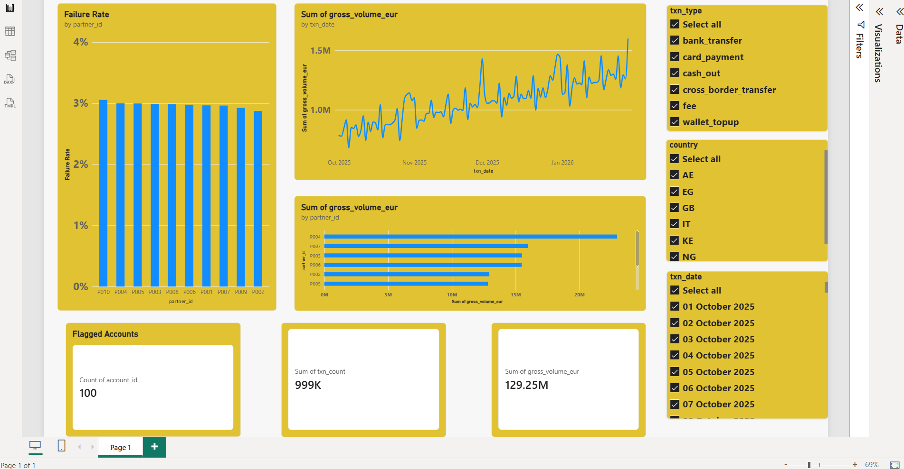
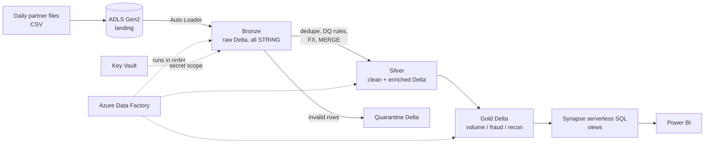
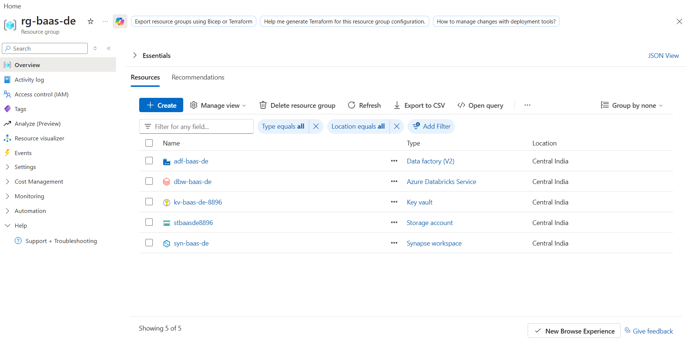
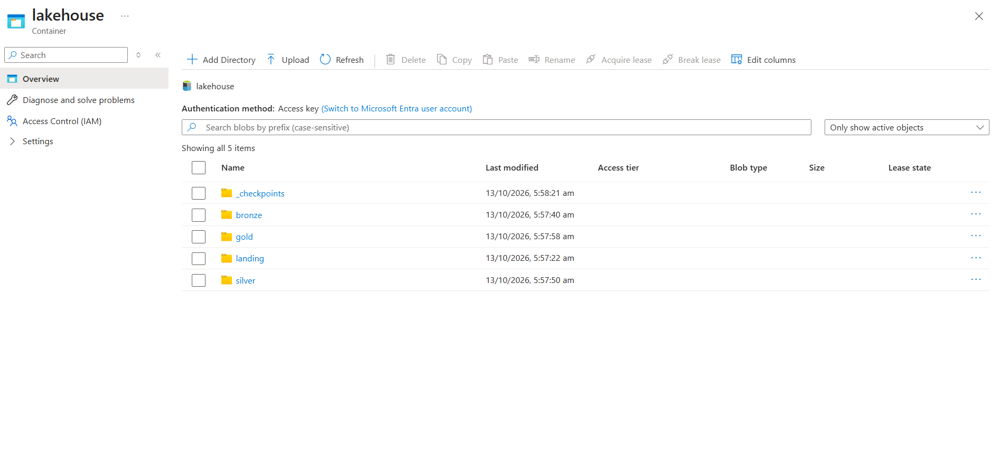
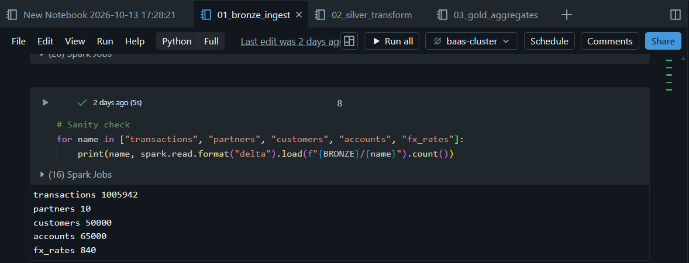
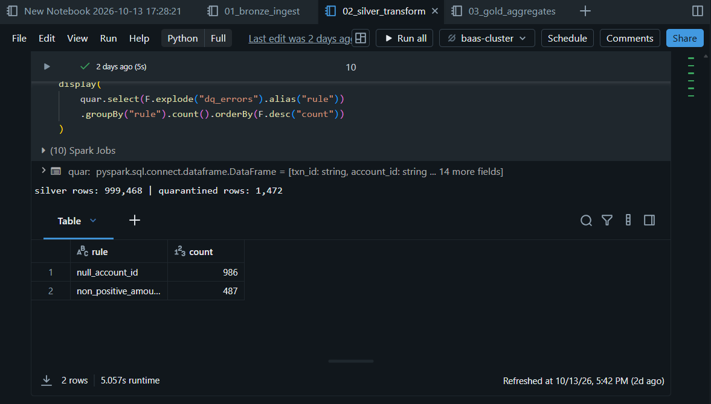
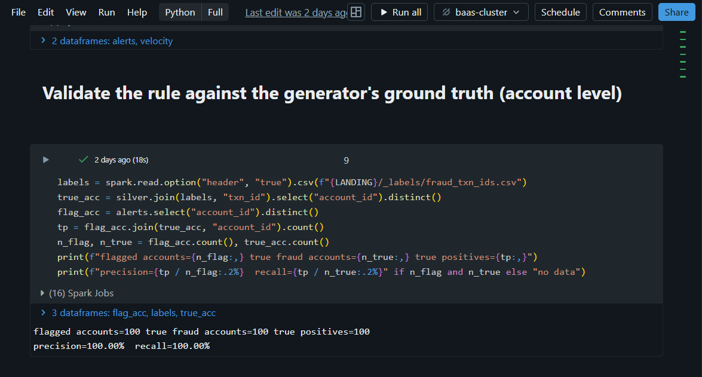
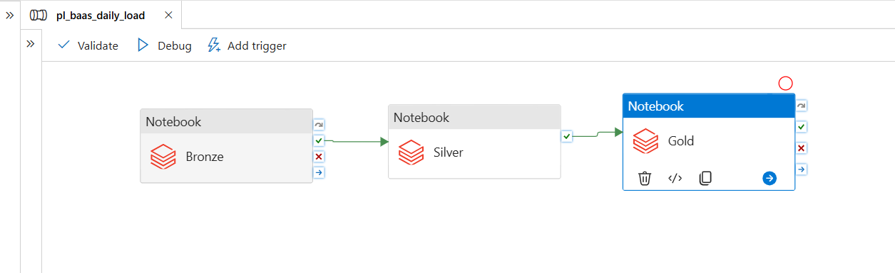
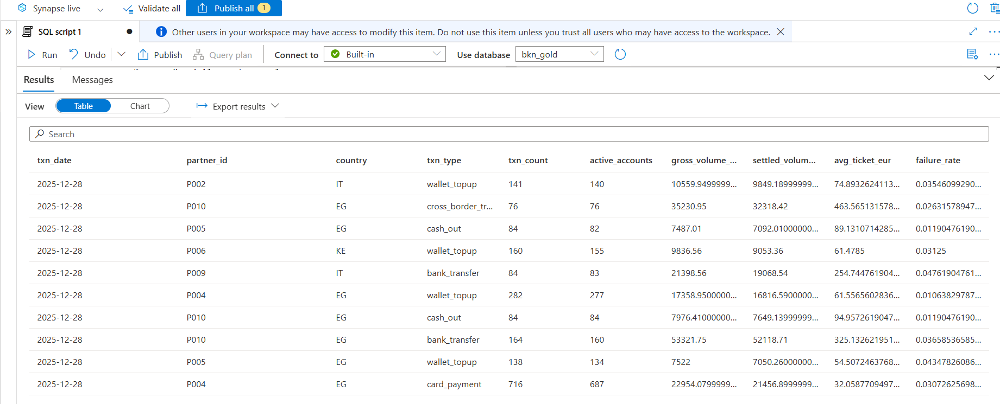

# BaaS Transaction Lakehouse on Azure


An end-to-end Azure data engineering project that ingests, cleans and models **~1 million synthetic multi-currency payment transactions** from a Banking-as-a-Service (BaaS) platform, then serves partner reporting, fraud monitoring and reconciliation insights through SQL and Power BI.

> **Note:** All data is randomly generated. This is a portfolio project inspired by how BaaS fintech platforms work in general. It is not affiliated with any company and uses no real or proprietary data.



---

## Table of contents
1. [Business problem](#business-problem)
2. [Architecture](#architecture)
3. [Dataset](#dataset)
4. [Pipeline walkthrough](#pipeline-walkthrough)
5. [Orchestration](#orchestration)
6. [Serving layer and dashboard](#serving-layer-and-dashboard)
7. [Security and cost practices](#security-and-cost-practices)
8. [Design decisions](#design-decisions)
9. [Repository structure](#repository-structure)
10. [How to reproduce](#how-to-reproduce)
11. [Limitations and future improvements](#limitations-and-future-improvements)
12. [Author](#author)

---

## Business problem

A BaaS platform serves many partners (neobanks, wallets, card issuers) across several countries and currencies. Each partner sends daily transaction files. The data team must:

- Ingest those files reliably, even with **duplicates, late files and bad rows**
- Produce **trusted, EUR-normalised** data for finance and partner reporting
- Flag **suspicious velocity patterns** for the risk team
- Surface **transactions stuck in `pending`** for reconciliation

## Architecture



| Azure service | Role in this project |
|---|---|
| **ADLS Gen2** | Data lake with `landing`, `bronze`, `silver`, `gold` folders |
| **Azure Databricks** (PySpark, Delta Lake) | Ingestion, cleaning, enrichment, aggregation |
| **Azure Data Factory** | Orchestrates Bronze, Silver and Gold notebooks in dependency order |
| **Azure Key Vault** | Stores the storage key, exposed to Databricks through a secret scope |
| **Azure Synapse (serverless SQL)** | SQL views over Gold Delta tables |
| **Power BI** | Partner, failure-rate and fraud dashboard |





## Dataset

Generated by [`data_generator/generate_data.py`](data_generator/generate_data.py) (fixed seed, reproducible).

| Dataset | Size |
|---|---|
| Transactions | 1,005,942 rows in 120 daily files (2025-10-01 to 2026-01-28), including replayed duplicates |
| Customers | 50,000 |
| Accounts | 65,000 (EUR, GBP, USD, EGP, KES, NGN, AED) |
| Partners | 10 fictional partners across 7 countries |
| FX rates | 840 rows (120 days x 7 currencies, to EUR) |

**Data problems injected on purpose** so the pipeline has real work to do:
duplicate rows (replayed the next day), missing `account_id`, lower-case currency codes, a second timestamp format, negative amounts, late-arriving rows, skewed "hot" accounts, and fraud-like bursts with ground-truth labels.

## Pipeline walkthrough

### Bronze: raw, append-only
- **Auto Loader** reads only new files from `landing`, with a checkpoint so re-runs are safe
- Everything is stored as `STRING` so dirty rows are never rejected at ingestion
- Adds `_source_file`, `_ingest_ts` and `ingest_date` for lineage



### Silver: clean, validate, enrich
- De-duplicates on `txn_id` (latest delivery wins)
- Parses two timestamp formats, upper-cases currency, casts amounts to `decimal(18,2)`
- Applies data-quality rules; failing rows go to a **quarantine table with the reasons** instead of being dropped:
  `null_account_id`, `bad_timestamp`, `non_positive_amount`, `unknown_currency`, `unknown_status`, `unknown_txn_type`
- Converts to EUR with daily FX and joins account, customer and partner attributes (broadcast joins)
- Loads with **Delta `MERGE`**, so replayed or late files never create double counts



### Gold: business-ready tables

| Table | Purpose |
|---|---|
| `daily_partner_volume` | Volume, active accounts, average ticket and failure rate by day, partner, country and transaction type |
| `fraud_velocity_alerts` | 5 or more cross-border / cash-out transactions within 10 minutes on one account, totalling at least EUR 1,500 (window function) |
| `reconciliation_exceptions` | Transactions still `pending` more than 3 days after the transaction date |

The fraud rule is **validated against the generator's ground-truth labels** (account-level precision and recall). It reaches 100% precision and 100% recall here because the injected fraud bursts follow a clear pattern by design; real-world fraud is far messier, so this validates the pipeline logic and the evaluation method, not production-grade fraud detection.



## Orchestration

An Azure Data Factory pipeline runs the three Databricks notebooks in dependency order (Bronze, then Silver, then Gold). A failure in any step stops the downstream steps.



`adf/pl_baas_daily_load.json` is a fuller reference template that also includes a source copy step and a failure alert.

## Serving layer and dashboard

Gold Delta tables are exposed through **Synapse serverless SQL views**, using the workspace managed identity (no keys in SQL). Power BI connects to those views.



The dashboard answers:
- How much volume is each partner moving, and how is it trending day by day?
- Which partners have the highest transaction **failure rate**?
- How many accounts were flagged by the **fraud velocity rule**?
- Which transactions need reconciliation follow-up?

## Security and cost practices

- **No secrets in code:** the storage key lives in Key Vault and is read through a Databricks secret scope
- **Least privilege for Synapse:** the workspace managed identity gets `Storage Blob Data Reader` only
- **Cost control:** single-node cluster with auto-terminate, Azure budget alert, and everything inside one resource group that can be deleted in one step

## Design decisions

| Decision | Why |
|---|---|
| Bronze stored as all `STRING` | Bad data never blocks ingestion, and raw data can always be replayed |
| Quarantine table instead of dropping rows | Data quality becomes measurable and auditable |
| Delta `MERGE` on `txn_id` + `txn_date` | Idempotent loads; handles duplicates and late-arriving data; partition pruning |
| `availableNow` Auto Loader trigger | Incremental, streaming-style processing at batch-job cost |
| Broadcast joins for FX and accounts | Small dimensions, avoids shuffling the large fact table |
| Fraud rule checked against labels | Precision and recall can be reported, not assumed |
| Serverless SQL over Delta | Pay per query, no dedicated warehouse needed for a reporting layer |

## Repository structure

```
.
├── README.md
├── data_generator/
│   ├── generate_data.py        # synthetic data generator
│   └── requirements.txt
├── notebooks/
│   ├── 01_bronze_ingest.py
│   ├── 02_silver_transform.py
│   └── 03_gold_aggregates.py
├── sql/
│   └── synapse_serverless_views.sql
├── adf/
│   └── pl_baas_daily_load.json  # reference pipeline template
└── screenshots/
```

## How to reproduce

1. Generate data: `pip install -r data_generator/requirements.txt`, then `python data_generator/generate_data.py --out landing --n-txn 1000000 --n-customers 50000 --days 120`
2. Create a resource group, an ADLS Gen2 storage account (hierarchical namespace ON) with a `lakehouse` container, and upload `landing/`
3. Store the storage key in Key Vault and create a Databricks secret scope on it
4. Create a Databricks workspace and cluster; import the three notebooks, set `<storageaccount>` in each, and run them in order
5. Create an ADF pipeline chaining the three notebooks (linked service: Azure Databricks)
6. Create a Synapse workspace, give its managed identity `Storage Blob Data Reader` on the storage account, then run `sql/synapse_serverless_views.sql`
7. Connect Power BI to the Synapse serverless endpoint (database `bkn_gold`) and build the visuals

## Limitations and future improvements

**Current limitations (known trade-offs of this version)**
- Storage access uses an account key through a Key Vault-backed secret scope. This is simple for a portfolio project, but production setups should use Unity Catalog with a managed identity or service principal
- The source is a daily file drop, so there is no real-time view of transactions
- Gold tables are fully rebuilt on each run instead of being updated incrementally
- The ADF pipeline chains the notebooks but has no schedule trigger, alerting or parameterised run date yet (the template in `adf/` shows the target design)
- The fraud rule is a fixed threshold rule, and it scores 100% only because the synthetic bursts are built to match it
- There are no automated tests or CI/CD yet, and infrastructure was created manually in the portal

**Future improvements (roadmap)**

| Area | Improvement | Why it matters |
|---|---|---|
| Streaming | Ingest transactions through **Event Hubs + Structured Streaming** | Near-real-time fraud alerts instead of next-day detection |
| Incremental processing | Update Gold with `MERGE` / `replaceWhere`, or move to **Delta Live Tables** (declarative pipelines) | Lower compute cost and faster runs as data grows |
| Orchestration | Add scheduled triggers, a `run_date` parameter, retries, failure alerts (Teams / email) and a source copy step in ADF | Hands-free daily operation with proper monitoring |
| Governance and security | Move to **Unity Catalog** with managed identity; add column masking for PII and row-level security per partner | Least privilege, auditability and partner data isolation |
| Data quality | Add **Great Expectations** or DLT expectations, a DQ trend dashboard and threshold alerts | Catch bad feeds early and track quality over time |
| Testing and CI/CD | `pytest` unit tests for transformation functions; **Azure DevOps / GitHub Actions** for notebook and ADF deployment | Safer, repeatable releases |
| Infrastructure as code | Define all resources with **Terraform** or **Bicep** | One-command, reproducible environments |
| Data modelling | **SCD Type 2** on customers (risk tier history) and a star schema for reporting | Correct historical reporting and simpler BI models |
| Fraud detection | Add an ML model (for example gradient boosting or isolation forest) with richer features, tested on noisier data | More realistic detection than a single threshold rule |
| Reconciliation | Match transactions against partner settlement files automatically | Faster resolution of pending / mismatched items |
| Performance | Handle hot-account skew (salting), schedule file compaction, and benchmark at 10x data volume | Shows how the design scales |
| Observability | Log run metrics (rows in / out, quarantine rate, freshness) to a table and **Log Analytics** | Data freshness SLAs and faster troubleshooting |
| Cost optimisation | Use job clusters (instead of an all-purpose cluster) for scheduled runs, and spot instances where safe | Lower cost per run |
| Power BI | Incremental refresh and row-level security by partner | Faster refresh and secure partner-specific views |
| Platform | Evaluate migrating to **Microsoft Fabric** (OneLake, Data Factory, Direct Lake) | Compare architectures and keep skills current |

## Author

**Vipin Kumar**, Data Analyst moving into Azure data engineering. Skills: SQL, Python, Power BI, Advanced Excel, Azure (ADF, Databricks, Synapse).

[LinkedIn](https://www.linkedin.com/in/YOUR-PROFILE) | [GitHub](https://github.com/YOUR-USERNAME)
